CFC Customer Interaction Management & Operational Analytics
A customer interaction management application supported by operational
dashboards for monitoring service activity, customer issues, workforce
attendance, product performance, incidents, and executive-level
performance.
> **Portfolio note:** This repository documents the project through
> screenshots and a functional walkthrough. Add or confirm the
> technology stack, your exact contribution, and any verified business
> results before publishing or sharing it.
1. Project Overview
The CFC Customer Interaction project brings together a customer
interaction capture workflow and a suite of operational analytics
dashboards. The application supports the recording and review of
customer cases, while the dashboards provide views of operational
activity and performance.
The project has two main parts:
Customer Interaction Management Application --- a workflow for
finding customer records, reviewing previous interactions, and
capturing new interactions with relevant case details.
Operational Analytics Dashboards --- dashboards presenting
interaction volumes, service trends, interval performance, workforce
attendance, product issues, incidents, and executive summaries.
2. Project Objectives
Provide a structured way to search for customer records and capture
customer interactions.
Make previous interaction history available when reviewing a
customer.
Organise cases by line of business, channel, interaction type,
category, and sub-category.
Make operational trends and performance indicators easier to review.
Support monitoring of workforce attendance, product-related issues,
and operational incidents.
Present key operational information in dashboards for management
review.
3. Application Walkthrough
3.1 Customer Interaction Home
The home screen provides the starting point for customer interaction
activities. Users can search for customer records and view the matching
customer profile and recent interaction history.
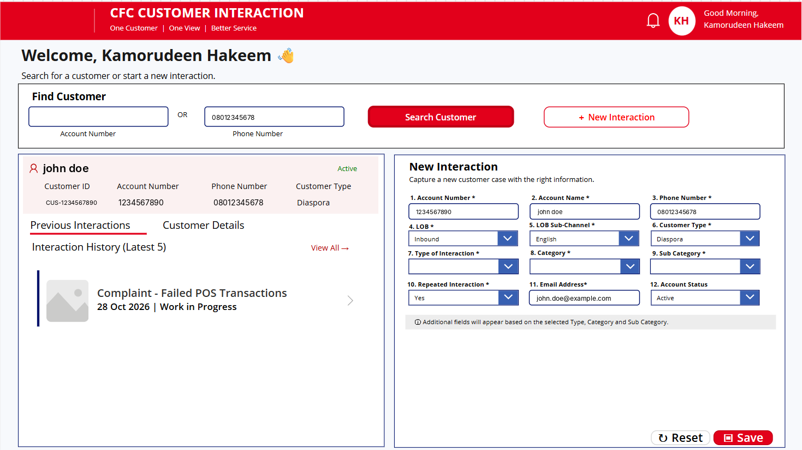
3.2 Customer Interaction Record Detail
The record detail view presents information captured for a previous
customer interaction, helping users review the case context and relevant
fields.
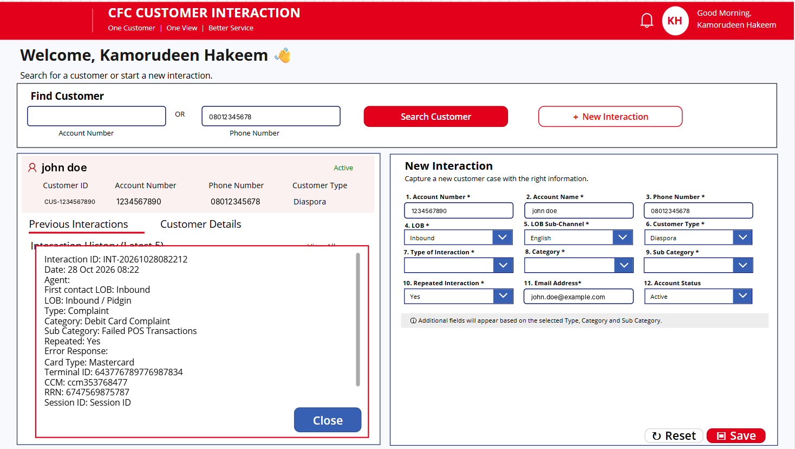
3.3 New Customer Interaction Form
The interaction form provides structured fields for capturing a new
case, including customer and account details, line of business, channel,
interaction type, category, sub-category, and other applicable
information.
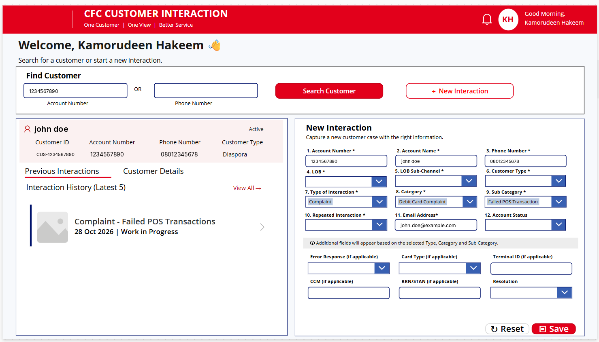
4. Operational Dashboard Walkthrough
The dashboards provide different views of operational activity. The
screenshots below show the dashboard pages included in this project.
4.1 Executive Interval Dashboard
Presents interval-level operational indicators, including interaction
volumes, complaints, requests, enquiries, abandonment, reporting-period
filters, and call-driver views.
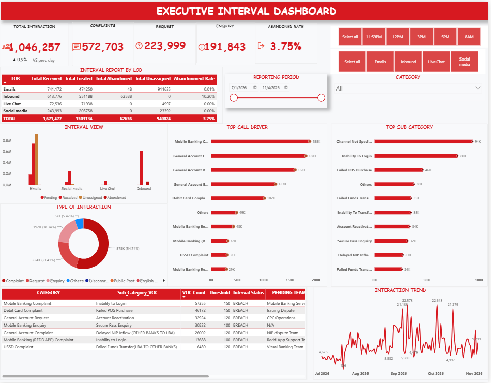
4.2 Operational Trend & Planning
Provides a historical view of interaction activity, channel
contribution, monthly trends, answer rate, average handling time, and
interaction breakdown.
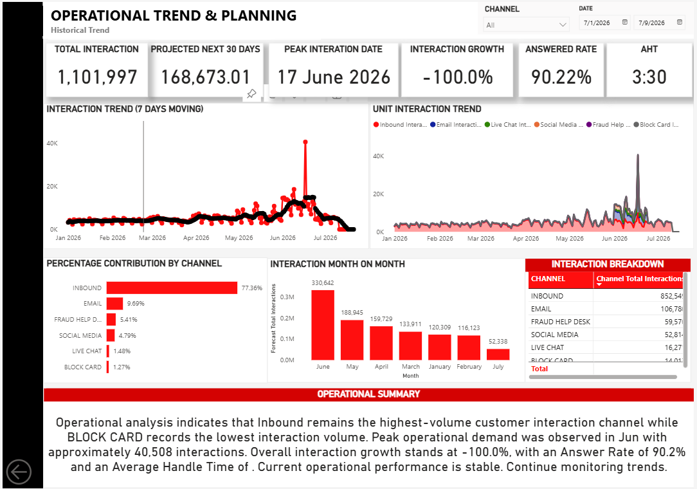
4.3 Interval Analysis Dashboard
Focuses on interaction performance by time interval, with measures such
as total interactions, resolved and open interactions, abandoned
interactions, response time, and interval resolution rate.
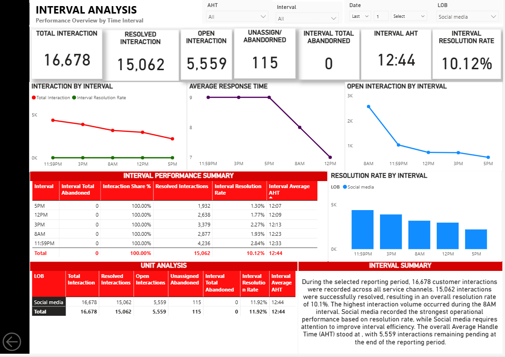
4.4 Workforce & Attendance Dashboard
Provides a workforce overview, including staff presence, absence, leave
categories, attendance and absenteeism trends, hub performance, and
team-level views.
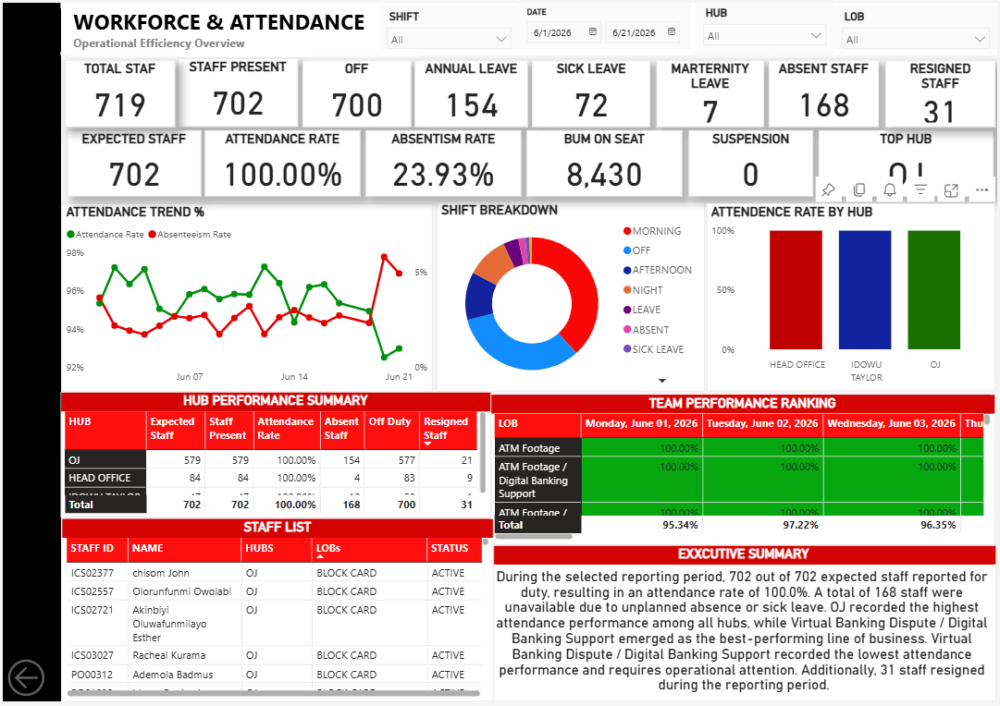
4.5 Product Performance Dashboard
Shows product-related interaction activity, product mix, complaint and
request trends, and frequently reported product issues.
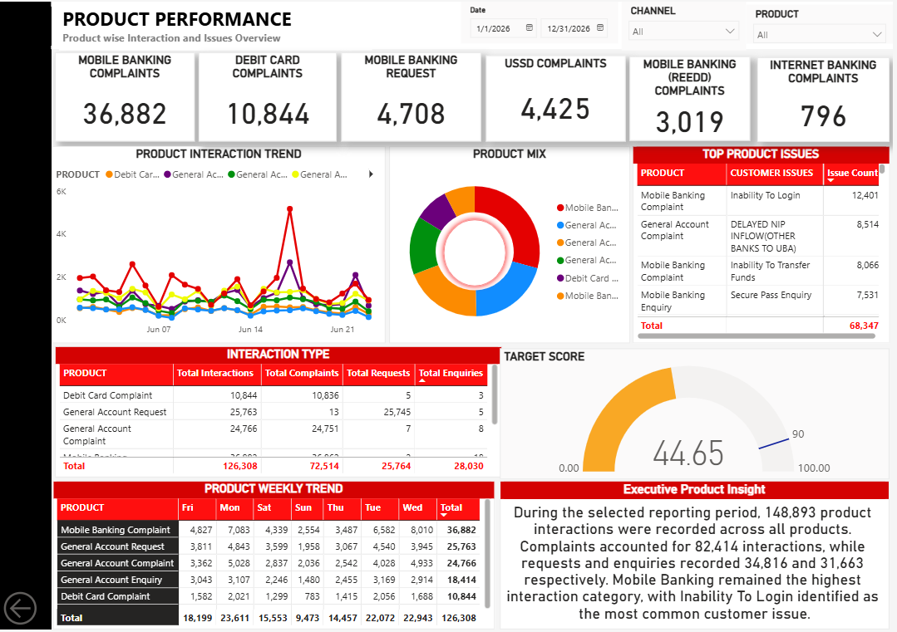
4.6 Incident Dashboard
Summarises operational incidents, incident types, impact, resolution
information, trends, and recorded root causes.
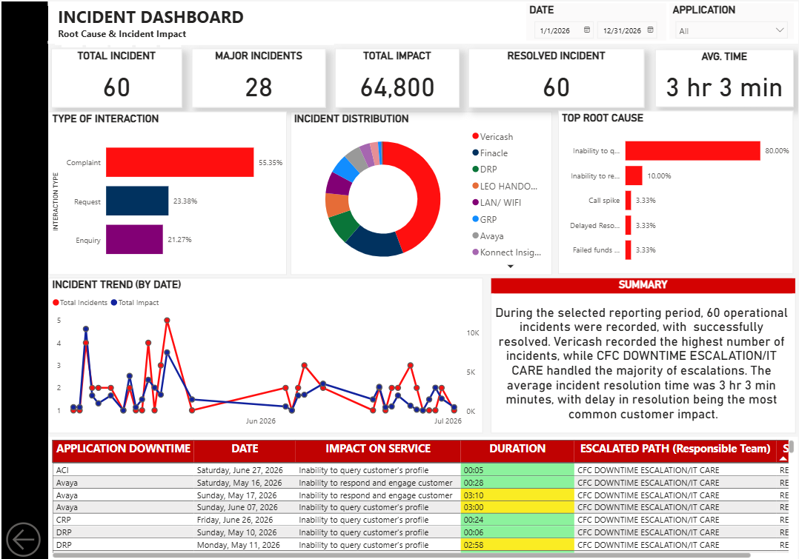
4.7 CFC Executive Command Centre
Brings together high-level operational indicators, channel contribution,
customer issues, product performance, and executive insights in one
view.
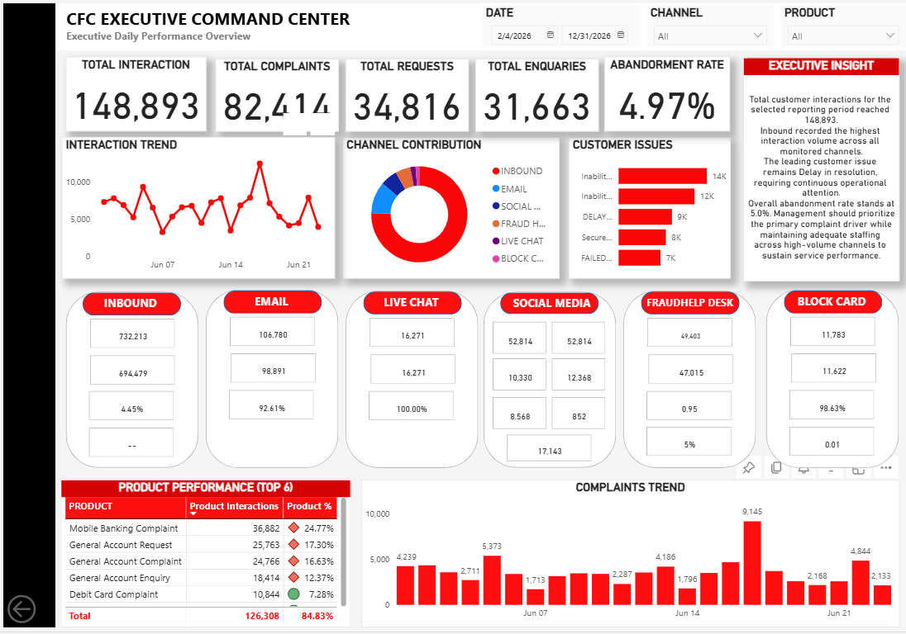
4.8 CFC Attendance Dashboard
Provides an additional attendance view, including expected attendance,
staff present and absent, attendance rate, workforce distribution, hub
and department comparisons, and attendance trends.
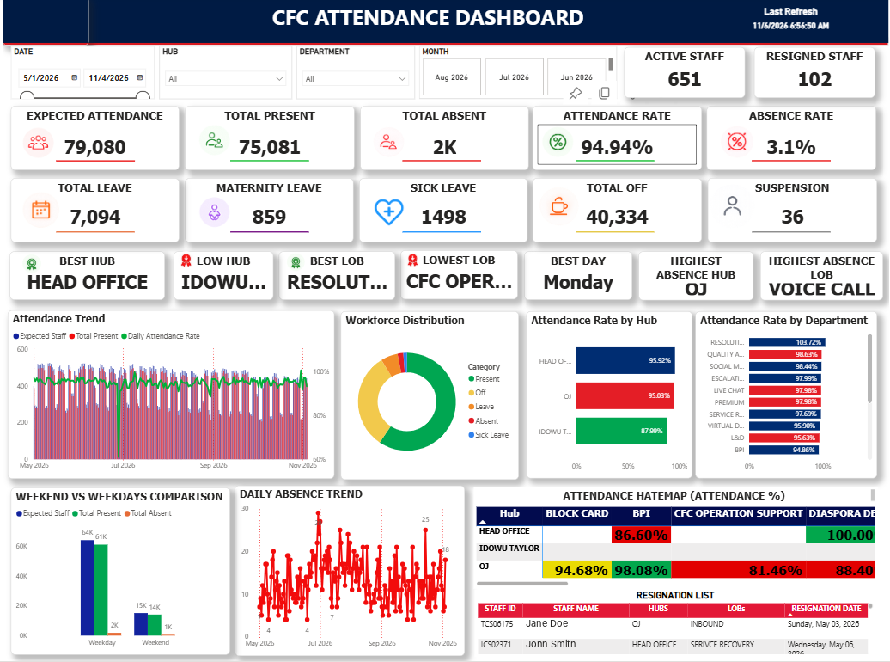
5. Key Features
Customer interaction application
Customer search and profile view.
Previous interaction history.
Structured new-interaction capture form.
Classification by line of business, channel, interaction type,
category, and sub-category.
Additional fields for relevant case information.
Operational dashboards
KPI cards and summary indicators.
Date and category filters.
Interaction and channel trend analysis.
Interval and service performance views.
Workforce attendance and absence monitoring.
Product issue and incident analysis.
Executive-level operational summaries.
6. Tools and Technologies

The project was developed using a combination of data analytics, business intelligence, application development, and workflow automation technologies.

Microsoft Excel: Data preparation, cleaning, organisation, analysis, and reporting.

Microsoft Power BI: Interactive dashboards, data visualisation, KPI monitoring, and operational performance reporting.

SQL: Data querying, extraction, manipulation, and analysis.

Python: Data processing, analysis, and automation.

Microsoft Power Apps: Development of the customer interaction management application and structured data capture forms.

Microsoft Power Automate: Workflow automation, process integration, and automated business processes.

These technologies work together to support data-driven decision-making, operational visibility, and process efficiency.

7. My Role and Contribution

I was responsible for designing and developing the customer interaction management solution and its supporting operational analytics dashboards.

My contributions included:

Application Development: Designed and developed the customer interaction management application using Microsoft Power Apps, providing a structured platform for customer information capture, interaction recording, and case review.

Dashboard Development: Developed interactive Power BI dashboards to monitor operational performance, customer interactions, workforce attendance, product performance, and incidents.

Data Preparation and Analysis: Used Excel, SQL, and Python for data preparation, cleaning, processing, and analysis to support accurate reporting and meaningful business insights.

Workflow Automation: Implemented automation processes using Microsoft Power Automate to support operational workflows and improve process efficiency.

Business Intelligence and Reporting: Translated operational data into meaningful visual reports, performance indicators, and management insights.

Solution Design and Improvement: Worked on structuring the application and dashboards to improve information accessibility, operational monitoring, and reporting.

8. Project Outcomes and Business Value

The solution provides a centralised approach to customer interaction management and operational performance monitoring.

Key business value includes:

Improved Interaction Management: Provides a structured approach to capturing, classifying, and reviewing customer interactions.

Enhanced Operational Visibility: Makes key performance indicators and operational trends accessible through interactive dashboards.

Better Decision-Making: Supports management decisions through data visualisation and performance analysis.

Workforce Monitoring: Provides visibility into employee attendance, absenteeism, and workforce distribution.

Customer Experience Monitoring: Helps identify recurring customer complaints, product-related issues, and operational service challenges.

Process Automation: Reduces reliance on repetitive manual activities through automated workflows.

Centralised Reporting: Brings different operational performance indicators together for easier monitoring and review.

Measured Results: Quantifiable improvements can be added as verified project performance results become available.

Contact

Project Owner: Kamorudeen Abdulhakeem

LinkedIn: https://www.linkedin.com/in/kamorudeenabdulhakeem/

Email: kamorudeenabdulhakeem@gmail.com
